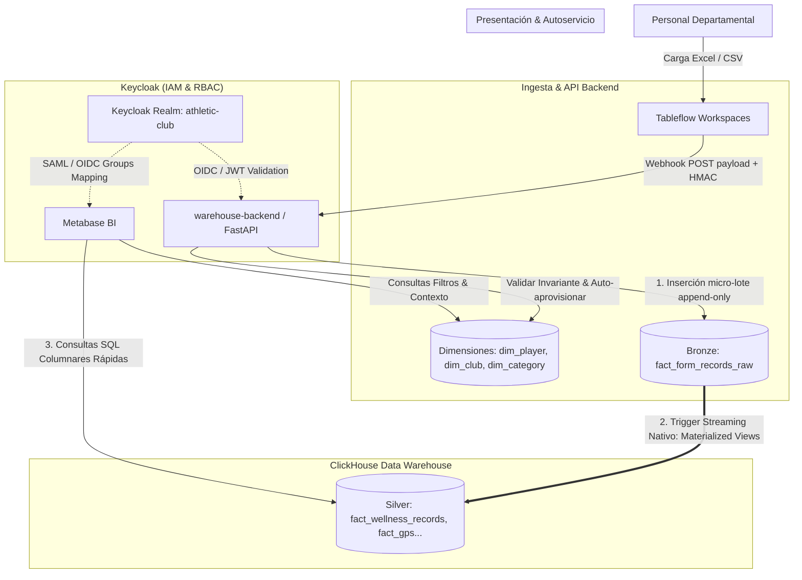
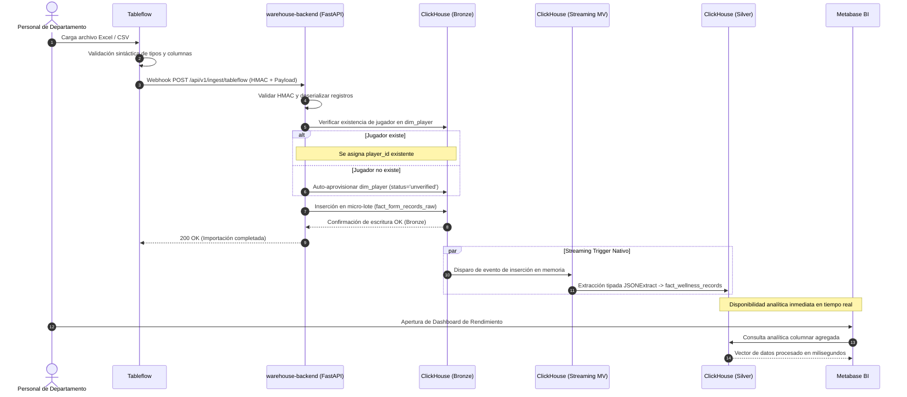

# ADR-0001: Arquitectura General de Athletic Warehouse y Flujos entre Componentes

- **Estado:** Aprobado
- **Fecha:** 2026-10-22
- **Contexto:** Athletic Warehouse (Sports Analytics & Data Platform)
- **Decisores:** Daniel Hernández (Lead / Stakeholder), Antigravity Architecture Agent

---

## 1. Contexto y Planteamiento del Problema

El club deportivo requiere una plataforma moderna, robusta y escalable de analítica deportiva (**Athletic Warehouse**) para centralizar datos provenientes de múltiples departamentos (Médico, Preparación Física, Scouting, Cantera y Dirección Deportiva).

### Desafíos y Requisitos Operativos
1. **Ingesta Descentralizada Heterogénea:** Los departamentos recopilan métricas mediante planillas de cálculo (Excel/CSV) y formularios diarios (RPE, tests de fuerza, GPS, cuestionarios de bienestar o wellness). La ingesta debe ser autónoma por departamento mediante **Tableflow**.
2. **Seguridad y Control de Acceso (RBAC):** Cada usuario pertenece a un departamento y rol específico. La autenticación y autorización deben centralizarse mediante **Keycloak** (OIDC/JWT).
3. **Validación de Invariantes de Negocio:** La plataforma debe verificar que cada registro esté asociado a un jugador válido dentro de la dimensión maestra de jugadores (`dim_player`), garantizando la consistencia analítica.
4. **Almacenamiento Analítico de Alto Rendimiento:** Se requiere un motor columnar OLAP (**ClickHouse**) capaz de agregar millones de métricas deportivas por segundo, optimizando el consumo para herramientas de Business Intelligence (**Metabase**).
5. **Evolución del Esquema sin Roturas:** Las métricas de los formularios cambian con el tiempo (nuevas preguntas o campos eliminados). El sistema no debe rechazar la ingesta ante cambios menores en los esquemas de formulario, preservando la trazabilidad completa.

---

## 2. Decisión Arquitectónica

Se adopta una arquitectura basada en desacoplamiento de componentes, principios de **Clean Architecture** en el servicio backend y el patrón **Medallion Streaming Architecture** en ClickHouse.



---

## 3. Especificación Detallada de Componentes

### 3.1. Gestión de Identidad y Acceso (Keycloak IAM & RBAC)
- **Realm:** `athletic-club`.
- **Estructura de Grupos por Departamento:**
  - `/Departamentos/Medico`
  - `/Departamentos/Preparacion-Fisica`
  - `/Departamentos/Scouting`
  - `/Departamentos/Cantera`
  - `/Departamentos/Direccion-Deportiva`
- **Roles Departamentales:**
  - `dept_admin`: Gestión departamental, configuración de formularios y supervisión de accesos.
  - `dept_analyst`: Acceso de solo lectura a dashboards analíticos y reportes en Metabase.
  - `dept_ingestor`: Permiso de carga e importación de archivos mediante Tableflow.
- **Propagación de Seguridad:**
  - `warehouse-backend` valida tokens JWT emitidos por Keycloak mediante JWKS asimétrico.
  - Metabase sincroniza pertenencia a grupos mediante mapeo OIDC/SAML para restringir colecciones y paneles sensibles por departamento.

### 3.2. Capa de Ingesta (Tableflow)
- **Workspaces Departamentales:** Se configuran espacios de trabajo aislados en Tableflow que corresponden 1:1 con los departamentos del club.
- **Validación Sintáctica Previa:** Cada formulario (ej. *Wellness Diario*, *GPS Post-Partido*) tiene una plantilla con reglas de validación en cliente (columnas requeridas, formatos numéricos y rangos).
- **Notificación por Webhook:**
  - Al completar la importación, Tableflow envía una petición `POST` al endpoint `/api/v1/ingest/tableflow` de `warehouse-backend`.
  - La petición incluye firma HMAC en las cabeceras (`X-Tableflow-Signature`) y el payload estructurado con metadatos del departamento y formulario.

### 3.3. Servicio de Aplicación (`warehouse-backend` - FastAPI & Clean Architecture)
Implementado con **Python 3.12+**, **FastAPI** y empaquetado con **`uv`**.

Estructura de capas concéntricas (Clean Architecture):
- **Capa de Dominio (`domain/`):**
  - Modelos puros: `Player`, `Club`, `Category`, `FormRecord`.
  - Excepciones y reglas de negocio: Validación de identificación única del jugador (clave natural: `[first_name, last_name, birth_date]`).
  - **Invariante de Identidad del Jugador:**
    - Si el jugador existe en `dim_player`, se asocia su `player_id`.
    - Si el jugador no existe, se ejecuta la política de **auto-aprovisionamiento preliminar**: se registra al jugador en `dim_player` con estado `status = 'unverified'` y slug determinista `[iniciales]-[DDMMYYYY]` (ej. `lm-24061987`), permitiendo que el flujo de ingesta continúe sin interrupción mientras se emite una alerta a los coordinadores para validación formal.
- **Capa de Aplicación (`application/`):**
  - Casos de uso (`IngestTableflowRecordsUseCase`, `ReconcileUnverifiedPlayersUseCase`).
  - Orquestación de validaciones, resolución de identidades y micro-lotes para ClickHouse.
- **Capa de Infraestructura y Adaptadores (`infrastructure/`):**
  - Adaptador ClickHouse mediante `clickhouse-connect` (pooling de conexiones nativas sobre puerto 9000).
  - Adaptador de autenticación Keycloak (validación de firma JWT).
  - Verificador de firmas HMAC para Tableflow.
- **Capa de Presentación (`presentation/`):**
  - Endpoints REST `/api/v1/ingest/tableflow` y `/health`.

### 3.4. Almacén de Datos OLAP (ClickHouse - Medallion Streaming)

#### A. Capa Dimensional (Star Schema)
Todas las dimensiones emplean el motor `ReplacingMergeTree` para garantizar idempotencia y resolución de duplicados en actualizaciones.

```sql
-- Dimensión de Clubes
CREATE TABLE dim_club (
    club_id UUID,
    name String,
    country LowCardinality(String),
    created_at DateTime DEFAULT now()
) ENGINE = ReplacingMergeTree()
ORDER BY club_id;

-- Dimensión de Categorías Deportivas
CREATE TABLE dim_category (
    category_id UUID,
    club_id UUID,
    name LowCardinality(String),
    sort_order UInt8,
    created_at DateTime DEFAULT now()
) ENGINE = ReplacingMergeTree()
ORDER BY (club_id, category_id);

-- Dimensión de Jugadores
CREATE TABLE dim_player (
    player_id UUID,
    club_id UUID,
    category_id UUID,
    first_name String,
    last_name String,
    nationality LowCardinality(String),
    birth_date Date,
    position LowCardinality(String),
    status Enum8('verified' = 1, 'unverified' = 2),
    updated_at DateTime DEFAULT now()
) ENGINE = ReplacingMergeTree(updated_at)
ORDER BY (club_id, player_id);
```

#### B. Capa Bronze (Raw Inmutable)
Recibe la ingesta bruta directamente de `warehouse-backend`. Preserva el documento JSON íntegro para trazabilidad y auditoría forense.

```sql
CREATE TABLE fact_form_records_raw (
    record_id UUID,
    club_id UUID,
    department_id LowCardinality(String),
    form_name LowCardinality(String),
    player_id UUID,
    category_id UUID,
    metric_date Date,
    ingested_at DateTime DEFAULT now(),
    raw_data String CODEC(ZSTD(3))
) ENGINE = MergeTree()
PARTITION BY toYYYYMM(metric_date)
ORDER BY (club_id, department_id, form_name, player_id, metric_date);
```

#### C. Capa Silver (Tablas Departamentales Fuertemente Tipadas)
Las tablas analíticas están normalizadas en columnas nativas (`UInt8`, `Float32`, `Nullable(...)`).

```sql
CREATE TABLE fact_wellness_records (
    record_id UUID,
    club_id UUID,
    player_id UUID,
    category_id UUID,
    metric_date Date,
    rpe Nullable(UInt8),
    sleep_quality Nullable(UInt8),
    muscle_soreness Nullable(UInt8),
    stress_level Nullable(UInt8),
    fatigue_level Nullable(UInt8),
    notes Nullable(String),
    ingested_at DateTime
) ENGINE = MergeTree()
PARTITION BY toYYYYMM(metric_date)
ORDER BY (club_id, metric_date, player_id);
```

#### D. Transformación Continua mediante Vistas Materializadas en Streaming
En ClickHouse, una `MATERIALIZED VIEW` funciona internamente como un **trigger atómico de inserción**. No requiere Airflow, crons ni procesos externos.

```sql
CREATE MATERIALIZED VIEW mv_wellness_records TO fact_wellness_records AS
SELECT
    record_id,
    club_id,
    player_id,
    category_id,
    metric_date,
    JSONExtract(raw_data, 'rpe', 'Nullable(UInt8)') AS rpe,
    JSONExtract(raw_data, 'sleep_quality', 'Nullable(UInt8)') AS sleep_quality,
    JSONExtract(raw_data, 'muscle_soreness', 'Nullable(UInt8)') AS muscle_soreness,
    JSONExtract(raw_data, 'stress_level', 'Nullable(UInt8)') AS stress_level,
    JSONExtract(raw_data, 'fatigue_level', 'Nullable(UInt8)') AS fatigue_level,
    JSONExtract(raw_data, 'notes', 'Nullable(String)') AS notes,
    ingested_at
FROM fact_form_records_raw
WHERE form_name = 'wellness';
```

#### E. Manejo de Variabilidad en JSON y Evolución de Esquema
1. **Campos Faltantes en el JSON:**
   - La función `JSONExtract(raw_data, 'campo', 'Nullable(T)')` evalúa de forma segura a `NULL` si la clave no existe en el JSON de una fila particular.
   - La ingesta nunca falla ni aborta por omisión de campos secundarios.
2. **Campos Nuevos o Adicionales en el JSON:**
   - Si un departamento agrega métricas no previstas (ej. `hydration_index`), el JSON crudo completo se almacena sin pérdida en `fact_form_records_raw` (Capa Bronze).
   - La vista materializada existente ignora las columnas no mapeadas sin generar excepciones.
3. **Evolución del Esquema Analítico (Schema Evolution):**
   - Cuando se decide exponer el nuevo campo a Metabase, se ejecuta:
     ```sql
     ALTER TABLE fact_wellness_records ADD COLUMN hydration_index Nullable(Float32);
     ```
   - Se actualiza la definición de la `MATERIALIZED VIEW`.
   - **Backfill Histórico Retroactivo:** Dado que Bronze conserva el histórico crudo, es posible recalcular los registros pasados en cualquier momento:
     ```sql
     INSERT INTO fact_wellness_records
     SELECT record_id, club_id, player_id, category_id, metric_date,
            JSONExtract(raw_data, 'rpe', 'Nullable(UInt8)'),
            ...,
            JSONExtract(raw_data, 'hydration_index', 'Nullable(Float32)'),
            ingested_at
     FROM fact_form_records_raw
     WHERE form_name = 'wellness' AND metric_date < '2026-10-22';
     ```

### 3.5. Capa de Visualización y Autoservicio (Metabase BI)
- **Conexión:** Solo lectura directa a ClickHouse sobre tablas de la Capa Silver y Dimensiones.
- **Ejecución de Consultas:** Todas las consultas SQL se procesan en el motor columnar de ClickHouse utilizando aceleración SIMD. Metabase actúa exclusivamente como capa de representación visual.
- **Autoservicio para Usuarios Finales:** Al consultar tablas fuertemente tipadas en Silver, los preparadores físicos y directores médicos pueden utilizar el constructor gráfico (*Visual Query Builder*) de Metabase sin necesidad de redactar sentencias SQL ni lidiar con funciones JSON complejas.

---

## 4. Diagrama de Secuencia de Ingesta



---

## 5. Consecuencias y Compensaciones (Trade-offs)

### Aspectos Positivos
- **Velocidad de Consulta Extrema:** Las consultas de Metabase se dirigen a columnas primitivas comprimidas, reduciendo el tiempo de respuesta de segundos a milisegundos.
- **Cero Infraestructura de Orquestación:** Al emplear Vistas Materializadas nativas como triggers en streaming, se prescinde de herramientas externas complejas (Airflow, Celery o Dagster) para la transformación Bronze -> Silver.
- **Resiliencia Operativa:** La ingesta no se bloquea ante esquemas cambiantes o jugadores nuevos; Bronze almacena todo el contenido y el auto-aprovisionamiento unverified asegura continuidad.
- **Trazabilidad y Auditoría:** Capacidad de re-procesar y auditar datos históricos completos desde la capa Bronze.

### Compensaciones Asumidas y Mitigaciones
- **Duplicación de Almacenamiento (Bronze + Silver):**
  - *Compensación:* El dato se almacena tanto en el blob raw como en la tabla tipada.
  - *Mitigación:* La compresión columnar de ClickHouse (ZSTD para texto y DoubleDelta/Gorilla para métricas numéricas) reduce la huella física en disco en más de un 75%.
- **Gestión de Migraciones en Vistas Materializadas:**
  - *Compensación:* Al añadir un nuevo campo en un formulario, debe modificarse la tabla Silver y recrearse la vista materializada para proyectar el nuevo valor.
  - *Mitigación:* Se automatizará mediante scripts de migración versionados en el repositorio de base de datos.
